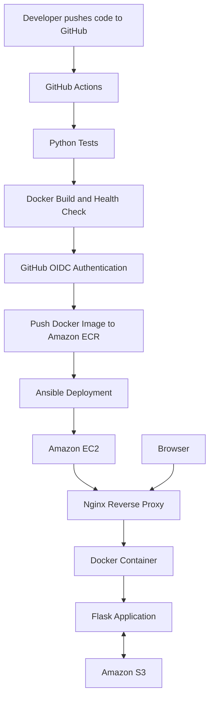

# Face Recognition System | Cloud & DevOps Project

A cloud-deployed face recognition application built with Python, Flask, OpenCV, Docker, AWS, Terraform, Ansible, and GitHub Actions.

This project demonstrates an end-to-end Cloud & DevOps workflow, including containerization, automated testing, CI/CD, infrastructure provisioning, configuration management, AWS integration, persistent storage, and HTTPS deployment.

---

## 1. Project Overview

The application allows users to register faces and recognize registered individuals through a browser-based interface.

It uses OpenCV's YuNet model for face detection and SFace for face recognition. Face embeddings and registration data are persisted in Amazon S3, allowing registered data to be recovered when an EC2 instance is replaced.

The application is deployed on AWS EC2 using Docker and Nginx, with GitHub Actions automating the build, image publishing, and deployment process.

**Live Demo:** https://facerecognition.jaganops.in

### Key Features

- Browser-based face registration and recognition.
- Face detection using OpenCV YuNet.
- Face recognition using OpenCV SFace.
- 128-dimensional face embeddings.
- Cosine similarity-based face matching.
- Configurable recognition threshold.
- Amazon S3-based registration data persistence.
- Automatic data restoration during application startup.
- Docker containerization with a non-root runtime user.
- Nginx reverse proxy and HTTPS.
- Automated CI/CD using GitHub Actions.
- AWS authentication through GitHub Actions OIDC.
- Infrastructure provisioning using Terraform.
- Application deployment using Ansible.
- Health-check endpoint for application monitoring.

---

## 2. Technology Stack

| Category | Technologies |
|---|---|
| Programming language | Python 3.12 |
| Backend | Flask |
| Computer vision | OpenCV, YuNet, SFace |
| Machine learning models | ONNX |
| Frontend | HTML, CSS, JavaScript |
| Application server | Gunicorn |
| Containerization | Docker |
| Cloud platform | AWS |
| Container registry | Amazon ECR |
| Compute | Amazon EC2 |
| Object storage | Amazon S3 |
| Infrastructure as Code | Terraform |
| Configuration management | Ansible |
| CI/CD | GitHub Actions |
| Authentication | GitHub Actions OIDC |
| Web server | Nginx |
| HTTPS | Certbot / Let's Encrypt |

---

## 3. Architecture

The project uses GitHub Actions to test the application, build its Docker image, publish the image to Amazon ECR, and deploy it to an EC2 instance using Ansible.

Application registration data is stored in Amazon S3 so it can survive EC2 instance replacement.



### Deployment Flow

1. Developer pushes changes to the GitHub repository.
2. GitHub Actions runs automated tests and validation.
3. Docker builds the application image.
4. The built container is started and its health endpoint is checked.
5. GitHub Actions authenticates with AWS using OIDC.
6. The Docker image is pushed to Amazon ECR.
7. Ansible connects to EC2 over SSH.
8. Ansible pulls the latest image and deploys the container.
9. Nginx forwards incoming web requests to the application.
10. The Flask application reads and writes registration data in Amazon S3.

---

## 4. Application Endpoints

| Endpoint | Method | Description |
|---|---|---|
| `/` | GET | Main application interface |
| `/register` | GET | Face registration interface |
| `/recognize` | GET | Face recognition interface |
| `/health` | GET | Application health check |
| `/api/status` | GET | Application and recognition-engine status |
| `/api/register` | POST | Register a face |
| `/api/recognize` | POST | Recognize faces in an uploaded image |

### Health Check

The `/health` endpoint returns:

- HTTP 200 when the recognition engine is ready.
- HTTP 503 when the recognition engine is unavailable.

### Application Status

The `/api/status` endpoint provides operational information, including:

- Recognition engine readiness.
- Number of registered users.
- Recognition model identifier.
- Cosine similarity threshold.
- Required registration samples.
- Legacy-data and incompatible-store indicators.
- Application uptime.

The endpoint does not return registered users' names.

---

## 5. Face Recognition Workflow

### Face Detection

The application uses OpenCV YuNet to detect faces in the input image.

### Face Recognition

OpenCV SFace generates a 128-dimensional face embedding for each detected face.

### Face Matching

The application compares the generated embedding with stored embeddings using cosine similarity.

The default cosine threshold is `0.60`, configurable through the application configuration.

A match is determined using the configured threshold. Recognition accuracy depends on image quality, lighting, face angle, registration samples, and other real-world conditions.

---

## 6. Project Structure

```text
face-recognition-app/
│
├── .github/
│   └── workflows/
│       └── cicd.yml
│
├── ansible/
│   ├── ansible.cfg
│   ├── deploy.yml
│   ├── inventory.ini.example
│   └── .gitignore
│
├── backend/
│   ├── services/
│   └── utils/
│
├── data/
│   ├── known_faces/
│   └── models/
│
├── frontend/
│
├── iam/
│   ├── EC2Role.trust.json
│   ├── ECRPullFaceRecognitionSystem.json
│   ├── FaceRecognitionS3AccessPolicy.json
│   ├── GitHubActionsDeploy.policy.json
│   ├── GitHubActionsOIDC.trust.json
│   └── GitHubActionsSshRule.policy.json
│
├── models/
│
├── scripts/
│
├── terraform/
│   ├── main.tf
│   ├── outputs.tf
│   ├── provider.tf
│   ├── variables.tf
│   ├── terraform.tfvars.example
│   └── .terraform.lock.hcl
│
├── tests/
│
├── app.py
├── config.py
├── Dockerfile
├── gunicorn.conf.py
├── deploy-infrastructure.ps1
├── requirements.txt
├── .dockerignore
├── .gitignore
└── README.md
```

---

## 7. Local Development

### Prerequisites

- Python 3.12
- Git
- Docker (optional for containerized execution)
- Required ONNX model files
- AWS credentials and an S3 bucket if testing S3 persistence

### Clone the Repository

```bash
git clone <YOUR_GITHUB_REPOSITORY_URL>
cd face-recognition-app
```

### Create a Virtual Environment

Windows PowerShell:

```powershell
python -m venv .venv
.\.venv\Scripts\Activate.ps1
```

Linux:

```bash
python3 -m venv .venv
source .venv/bin/activate
```

### Install Dependencies

```bash
python -m pip install --upgrade pip
pip install -r requirements.txt
```

### Configure the Application

Review `config.py` and `.env.example` where applicable.

Configure the required environment variables, model files, and AWS access before running the application with S3 persistence enabled.

Do not commit `.env` files or AWS credentials.

### Run the Application

```bash
python app.py
```

Open the application in your browser using the local address configured by Flask.

---

## 8. Docker

The application is packaged as a Docker image.

The Docker build uses a multi-stage approach to separate build dependencies from the runtime image. The runtime uses a non-root user and Gunicorn to serve the Flask application.

### Build the Image

```bash
docker build -t face-recognition-system:latest .
```

### Run the Container

Configure the required environment variables and AWS access before starting the container.

```bash
docker run -d \
  --name face-recognition-system \
  -p 5000:5000 \
  face-recognition-system:latest
```

The command above illustrates local container execution. S3-backed operation requires the appropriate bucket configuration and AWS permissions.

### Verify the Container

```bash
docker ps
docker logs face-recognition-system
```

Check the health endpoint:

```bash
curl http://localhost:5000/health
```

Expected healthy response:

```json
{
  "status": "healthy"
}
```

### Stop and Remove the Container

```bash
docker rm -f face-recognition-system
```

---

## 9. AWS Architecture and Prerequisites

The project uses existing AWS resources and provisions an EC2 instance through Terraform.

### AWS Services

| AWS Service | Purpose |
|---|---|
| Amazon EC2 | Hosts the application |
| Amazon ECR | Stores Docker images |
| Amazon S3 | Stores persistent registration data |
| IAM | Controls AWS permissions |
| OIDC | Authenticates GitHub Actions to AWS |

### Existing Resources Required

Before deployment, configure:

- An AWS VPC and subnet.
- An EC2 security group.
- An EC2 key pair.
- An IAM role and instance profile for EC2.
- An Amazon ECR repository.
- An Amazon S3 bucket.
- A GitHub Actions OIDC identity provider.
- An IAM role for GitHub Actions.
- DNS records pointing to the EC2 deployment.

The IAM policy templates in the `iam/` directory provide a starting point. Review and customize their account, repository, resource, and permission values before using them.

---

## 10. Amazon S3 Persistence and Recovery

Amazon S3 is used to persist face registration data independently of the EC2 instance.

### Data Persistence

When a user registers a face:

1. The application processes the registration samples.
2. It generates the corresponding face embeddings.
3. Registration data and associated files are uploaded to S3.
4. The application maintains its local working data.

### Data Recovery

During application startup:

1. The application checks the configured S3 bucket.
2. It restores the existing registration data.
3. The recognition store is initialized using the restored data.
4. The application becomes ready when the recognition engine is available.

S3 is the persistent storage layer. The Docker container does not rely on a Docker volume for permanent registration data.

### Recovery Verification

Cross-instance recovery was tested:

1. Registration data was uploaded to S3.
2. The original EC2 instance was terminated.
3. The S3 object was verified to remain available.
4. A replacement EC2 instance was created.
5. The replacement instance accessed the existing S3 data.

This verified that registration data could survive EC2 replacement.

---

## 11. Terraform Infrastructure Provisioning

Terraform provisions one EC2 instance using existing AWS resources.

### What Terraform Manages

| Resource | Configuration |
|---|---|
| EC2 instance | One Amazon Linux 2023 instance |
| Instance type | `t3.small` by default |
| Root volume | 15 GB encrypted gp3 |
| Public IP | Enabled |
| Instance metadata | IMDSv2 required |
| AMI | Latest Amazon Linux 2023 AMI selected through a data source |

Terraform also reads the existing default VPC, its subnets, and the selected AMI through data sources.

### What Terraform Does Not Manage

- VPC and subnet creation.
- Security group creation.
- EC2 key pair creation.
- IAM role and instance profile creation.
- ECR repository creation.
- S3 bucket creation.
- GitHub OIDC provider and IAM role creation.
- DNS records.
- Elastic IP allocation.
- Docker, Nginx, and application configuration.

These resources must already exist or be configured separately.

### Terraform State

The project uses local Terraform state.

The `terraform.tfstate` file maps Terraform resources to real AWS resource IDs. It is excluded from Git.

Never commit the state file or delete it while Terraform is expected to manage the existing instance.

The `.terraform.lock.hcl` file should remain committed because it records the selected provider version.

### Provision Infrastructure

Windows PowerShell:

```powershell
.\deploy-infrastructure.ps1
```

The script:

1. Checks that Terraform and AWS CLI are available.
2. Checks AWS authentication.
3. Initializes Terraform.
4. Validates the configuration.
5. Generates a saved execution plan.
6. Displays the plan.
7. Waits for explicit confirmation by typing `yes`.
8. Applies the exact saved plan.
9. Displays the instance ID and public IP.

Read the plan carefully before approving it.

### Customize Terraform Variables

Copy the example file:

```powershell
Copy-Item terraform\terraform.tfvars.example terraform\terraform.tfvars
```

Update the values to match your AWS environment.

The default key pair, security group, and instance profile values are examples of existing resources. Replace them with your own when forking the project.

### Static Validation

```powershell
cd terraform
terraform fmt -check
terraform init -backend=false
terraform validate
```

These checks validate the Terraform configuration without provisioning infrastructure.

### Important Infrastructure Limitation

The configuration does not allocate an Elastic IP.

A replacement EC2 instance can receive a different public IP. If this happens, update the DNS record and the GitHub Actions `EC2_HOST` secret.

If you configure the optional `EC2_KNOWN_HOSTS` secret with a pinned host key, update that value as well when the host identity changes.

---

## 12. Ansible Deployment

Ansible automates application deployment on the EC2 instance.

The deployment playbook is located at:

```text
ansible/deploy.yml
```

### Deployment Responsibilities

Ansible performs the server-side deployment tasks, including:

- Preparing the EC2 environment.
- Installing and configuring Docker.
- Authenticating with Amazon ECR using the EC2 instance role.
- Pulling the application image.
- Running the Docker container.
- Configuring Nginx as a reverse proxy.
- Configuring HTTPS through Certbot when the required deployment settings are supplied.
- Verifying application health.

The application container listens on port 5000 internally. Ansible configures it to bind to:

```text
127.0.0.1:5000
```

Nginx forwards external requests to the application.

### SSH Host-Key Checking

Ansible has SSH host-key checking enabled.

The deployment workflow supports two ways to populate `known_hosts`:

1. Use the optional GitHub Actions secret `EC2_KNOWN_HOSTS` containing trusted host-key entries.
2. If the secret is not configured, the workflow uses `ssh-keyscan` to retrieve the host key before connecting.

The second method provides strict checking against the retrieved key during the connection, but it does not independently authenticate the key on first retrieval.

For stronger host authentication, configure a trusted host-key entry through `EC2_KNOWN_HOSTS`.

---

## 13. GitHub Actions CI/CD

The workflow is located at:

```text
.github/workflows/cicd.yml
```

It automates application testing, Docker image building, image publishing, and deployment.

### CI/CD Pipeline

The workflow contains four jobs.

| Job | Responsibilities |
|---|---|
| `test` | Python compilation, model checks, pytest, Ansible syntax validation, Terraform validation |
| `docker-build` | Builds the Docker image, starts a test container, and verifies `/health` |
| `push-to-ecr` | Authenticates to AWS and pushes the image to Amazon ECR |
| `deploy` | Uses Ansible to deploy the published image to EC2 |

### Pipeline Execution

CI runs on pushes and pull requests targeting the `main` branch.

CD runs after successful CI for pushes to `main`, or through a manual workflow dispatch on `main`.

The image is published using both:

- The commit SHA tag.
- The `latest` tag.

### GitHub Actions OIDC

GitHub Actions uses OpenID Connect to obtain temporary AWS credentials.

This avoids storing long-lived AWS access keys in GitHub repository secrets.

The AWS IAM trust policy must authorize the correct GitHub repository and branch.

**Important when creating a new repository:** update the OIDC trust policy's repository and branch subject condition to match the new repository before running the deployment workflow.

### Required GitHub Secrets

Configure these secrets under:

`GitHub Repository → Settings → Secrets and variables → Actions`

| Secret | Purpose |
|---|---|
| `AWS_ROLE_TO_ASSUME` | IAM role ARN assumed through OIDC |
| `EC2_HOST` | EC2 public IP address or DNS hostname |
| `EC2_SSH_PRIVATE_KEY` | Private SSH key used by Ansible |

The SSH private key is a long-lived deployment credential. Store it only as a GitHub secret and protect access to the repository.

### Optional GitHub Secrets

| Secret | Purpose |
|---|---|
| `EC2_KNOWN_HOSTS` | Trusted SSH host-key entries |

When this optional secret is absent, the workflow uses `ssh-keyscan` to populate `known_hosts`.

### Optional GitHub Variables

| Variable | Purpose |
|---|---|
| `EC2_SECURITY_GROUP_ID` | Enables the workflow's temporary SSH security-group access rule |
| `APP_URL` | Public application URL used for deployment verification |
| `CERTBOT_EMAIL` | Email address supplied to Certbot for HTTPS setup |

Only configure these optional values when the corresponding workflow functionality is required.

### Temporary SSH Access

When `EC2_SECURITY_GROUP_ID` is configured, the workflow can temporarily allow SSH access from the GitHub Actions runner.

The workflow removes the temporary rule after deployment.

Ensure the IAM role has the permissions required for this operation.

### Updating EC2 Host Information

If Terraform replaces the EC2 instance:

1. Obtain the replacement instance's public IP or DNS name.
2. Update the GitHub Actions `EC2_HOST` secret.
3. Update the DNS record if required.
4. Update `EC2_KNOWN_HOSTS` only if you use the optional pinned-host-key configuration.
5. Re-run the deployment workflow.

If you reuse the same EC2 key pair, the SSH private key does not need to change. Update `EC2_SSH_PRIVATE_KEY` only if the key pair changes.

---

## 14. Testing and Validation

The project includes automated tests and infrastructure validation.

### Python Compilation

```bash
python -m compileall -q .
```

### Python Tests

```bash
pytest
```

### Docker Build

```bash
docker build -t face-recognition-system:ci .
```

### Container Health Verification

Start the test container and verify:

```bash
curl http://localhost:5000/health
```

The expected healthy response is HTTP 200.

### Ansible Syntax Validation

```bash
ansible-playbook --syntax-check ansible/deploy.yml
```

### Terraform Validation

```bash
cd terraform
terraform fmt -check
terraform init -backend=false
terraform validate
```

The GitHub Actions workflow executes the relevant validation steps automatically.

---

## 15. Security Considerations

This project demonstrates cloud deployment and DevOps practices. It is not a production-ready biometric identity platform.

Important security considerations:

- The demonstration application does not implement user authentication.
- Public access to registration and recognition functionality should not be treated as secure identity verification.
- Face images and biometric embeddings are sensitive data and require appropriate access controls.
- Restrict S3 bucket access to the required IAM roles.
- Keep AWS credentials, SSH private keys, environment files, and Terraform state out of Git.
- Use least-privilege IAM policies.
- Restrict EC2 security-group ingress to required ports.
- Use HTTPS for public application traffic.
- Protect GitHub repository secrets and workflow permissions.
- Review IAM policies before deploying them in another AWS account.
- Configure appropriate S3 encryption, retention, and access policies for the data being stored.

The application exposes operational status information, including the number of registered users, through `/api/status`. It does not expose registered users' names through that endpoint.


---

## 16. Known Limitations

- The project uses one EC2 instance and does not provide high availability.
- Terraform state is local rather than stored in a remote backend.
- No Elastic IP is provisioned by Terraform.
- Replacing EC2 may require updating DNS and GitHub Actions configuration.
- The application does not implement authentication or user authorization.
- Recognition results depend on image quality and environmental conditions.
- The project is intended for learning and portfolio demonstration, not production biometric identification.

---

## 17. Repository Setup Checklist

When deploying this project in your own AWS account and GitHub repository:

- [ ] Configure the AWS CLI and verify AWS authentication.
- [ ] Create or identify the required VPC, subnet, security group, and EC2 key pair.
- [ ] Configure the EC2 IAM role and instance profile.
- [ ] Create the ECR repository.
- [ ] Create and configure the S3 bucket.
- [ ] Configure the GitHub Actions OIDC provider.
- [ ] Create the GitHub Actions IAM role and required policies.
- [ ] Update the OIDC trust policy for your GitHub repository and branch.
- [ ] Review and customize Terraform variables.
- [ ] Configure the GitHub Actions secrets.
- [ ] Configure optional GitHub Actions variables if required.
- [ ] Provision the EC2 instance using Terraform.
- [ ] Update `EC2_HOST` with the instance public IP or DNS name.
- [ ] Configure DNS and HTTPS settings.
- [ ] Run the GitHub Actions workflow.
- [ ] Verify the public application and `/health` endpoint.
- [ ] Test S3 persistence and recovery.

---

## 18. Learning Outcomes

This project provides practical experience with:

- Building and deploying a Python application.
- Integrating OpenCV-based machine learning models.
- Containerizing applications with Docker.
- Managing application images using Amazon ECR.
- Deploying applications on Amazon EC2.
- Persisting application data using Amazon S3.
- Managing AWS access using IAM and OIDC.
- Provisioning cloud infrastructure with Terraform.
- Automating server configuration using Ansible.
- Building CI/CD pipelines using GitHub Actions.
- Configuring Nginx reverse proxy and HTTPS.
- Performing health checks and deployment verification.
- Understanding infrastructure lifecycle and recovery.

---

## Author

**V Jagan**

Cloud & DevOps Portfolio Project